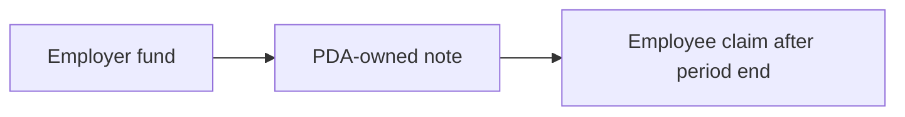

# pproll

Private payroll. One employer, one employee, one cadence. This is not `pescrow`. A swap spends both notes. A salary spends one. The programs do not share an account.



The amount and the asset stay in the note. The stream stores no mint and no amount. Parties, `start_at`, and `period_secs` are public and freeze when both have approved. Pay is at the end of the period: index `k` can be claimed when `Clock >= start_at + (k + 1) * period_secs`.

The employer funds each period from their own shielded balance. There is no budget vault. A funded period has no cancel and no employer reclaim. `stop` only blocks a later fund. Already funded notes stay claimable. At most 16 funded periods can be unclaimed. Funds and claims are in order.

The path that opens today is the permissionless ring with public wallets. Private wallets on that ring are rejected, because the ring prints both addresses. A custom ring is rejected until its program id is set.

## Accounts

Both accounts are created by the client and owned by this program. The note owner is a PDA, not the stream. Seeds are `payroll-lock`, the stream address, and the period index as 4 little-endian bytes. The bump is derived at the invoke. A fund does not sign that PDA: the pool hashes every signer into the transact proof, and the funded note's owner is an output. A claim signs it, because the PDA spends the note. A bump stored on the stream would sign the wrong period.

Stream, 104 bytes, tag `2`:

| Offset | Field |
| --- | --- |
| 0 | tag |
| 1 | status: `Proposed` 1, `Active` 2, `Stopped` 3, `Closed` 4 |
| 2 | employer approved |
| 3 | employee approved |
| 4 | terms frozen |
| 5 | ring |
| 6 | wallets |
| 7 | reserved, always 0 |
| 8 | `start_at` i64 |
| 16 | approval deadline i64 |
| 24 | `period_secs` i64 |
| 32 | employer |
| 64 | employee |
| 96 | `next_fund` u32 |
| 100 | `next_claim` u32 |

Period, 72 bytes, tag `3`. `fund` writes it. `claim` marks it claimed, then the entrypoint returns its rent to the employer.

| Offset | Field |
| --- | --- |
| 0 | tag |
| 1 | `Funded` 1 or `Claimed` 2 |
| 4 | index u32 |
| 8 | stream |
| 40 | commitment, 32 bytes |

## Instructions

`fund` and `claim` read their public inputs from these accounts, not from the client proof. The commitment is written only after the privacy program returns. The CPI accepts only `ring1GaLCuJnkUMVkX2JeZLTTX17wKsV4fZmPVzXANW`.

`fund` and `claim` verify their own Groth16 keys, then invoke the pool. Those circuits are not the escrow lock, swap, or give-back. A proof that does not match the accounts is `ProofRejected` (118) and writes nothing.

| Instruction | Who signs | What it does |
| --- | --- | --- |
| `create` | employer | `Proposed`. Rejects the same wallet on both sides, a deadline after `start_at`, and a period that is not positive. |
| `approve` | employer or employee | Strictly before the deadline and `start_at`. The second approval freezes the schedule. |
| `decline` | either party | `Closed`, only while `Proposed`, inside the window, and before any fund. |
| `fund` | employer | Index must be `next_fund`. Writes that period's commitment after the invoke. The first one sets `Active`. |
| `claim` | employee | Index must be `next_claim`, and the clock must be at or after that period's end. |
| `stop` | employer | `Active` becomes `Stopped`. |
| `close` | either party | Rent back to the employer when nothing is unclaimed. `Active` must `stop` first. `Closed` can be closed again so a declined stream can recover rent. |

`cargo test` covers those rules. A live fund still needs a Merkle path for the employer's note. That is the same indexer block as escrow, and it does not block the account rules.

The main risk is that the Default ring still publishes the employer, the employee, and the payday. Only the salary amount is hidden, and only while it stays in the note. A funded period the employee never claims stays in the PDA-owned note.

## Devnet

Program `5e6tZK4jSgHWUDW64PqRQwJBgN9VpgFEpcYiw5N9Lux6`.

The open stream is `9EReUpZdvHUMx7pjh5GjQghuBFrRbZeSwgWHU4MtwFZW`. Payer `AoBDpQ9KRQ1GBtnu1QURmdDv7RgN4Qyr5EWSkQzgF1B8`, recipient `YrSYDo5dYGbnhGMASAAthdy3tgmXvgj8sF79WHwdDi5`. Both have approved. It is hourly. The first claim opens at `2026-11-07T21:30:24Z`. The deployer `8PNkCj…` is not a party. The earlier streams are closed.

Run each step yourself from this directory. `fund` and `claim` refuse to send until you pass a 128-byte proof, the privacy payload, and the pool account list. Line 3 of that list must be the privacy program. The program verifies that proof before it asks the pool to move the note.

```bash
npm install
node scripts/create_stream.mjs <program-keypair> <employer-keypair> <employee-pubkey> <stream-keypair> --period 3600
node scripts/approve_stream.mjs <program-id> <stream> <party-keypair> [--payer <keypair>]
node scripts/fund_stream.mjs <program-id> <employer-keypair> <stream> <period-keypair> --commitment <hex> --proof <file> --transact <file> --accounts <file>
node scripts/claim_stream.mjs <program-id> <fee-payer-keypair> <employee-keypair> <stream> <period> --proof <file> --transact <file> --accounts <file>
node scripts/close_stream.mjs <program-id> <stream> <employer-keypair>
```
